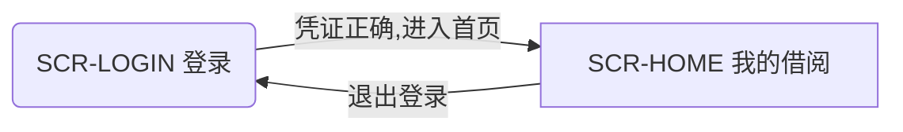

页 §NAV · 界面导航 · 1/1 · 共 38 行 · 页类 card
项目 demo · zh-CN · u=9da9bdd5 · 原型界面 · 核对是否过期: gemarc_atlas_index scope="stamp"
# 界面导航

> 含: 界面 2 个、导航 2 条（图里 2 条）
> 不含: 控件级明细见各屏画面卡；跨分片的导航只在表里
> 读法: 图里的 n1 n2 是别名，对照表给出屏幕 id；起点屏幕在别名表里标 start

## 导航图（2）

## 别名对照（2）
| 别名 | 屏幕 | 起点 |
|---|---|---|
| n1 | `SCR-LOGIN` | start |
| n2 | `SCR-HOME` |  |

## 导航表（2）
| id | 文字 | 条件 | 触发 | 链接 | 终点所在页 |
|---|---|---|---|---|---|
| `SCR-LOGIN.submit:go:SCR-HOME` | 凭证正确,进入首页 | 凭证正确 | submit | case=CS-BORROW-OK rule=R-BORROW |  |
| `SCR-HOME.logout:go:SCR-LOGIN` | 退出登录 |  | tap |  |  |

## 不可达屏幕（0）
（无）

## 没有出向导航的屏幕（0）
（无）

邻页: [START](../START.md)
页尾 §NAV · 共 38 行 · sha8 dac78cde · 以上为全部内容
